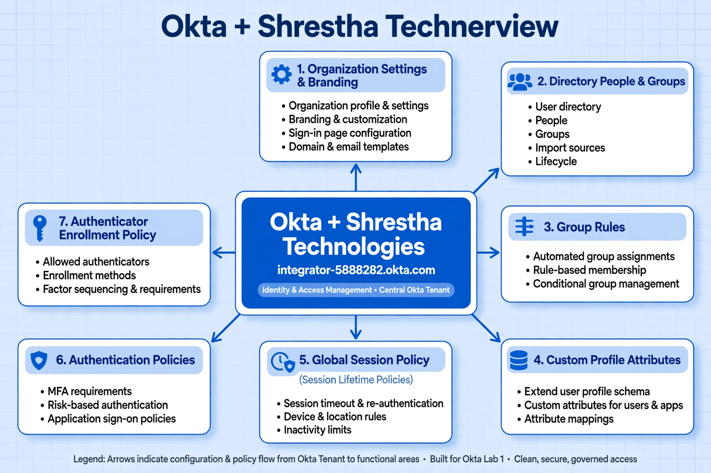
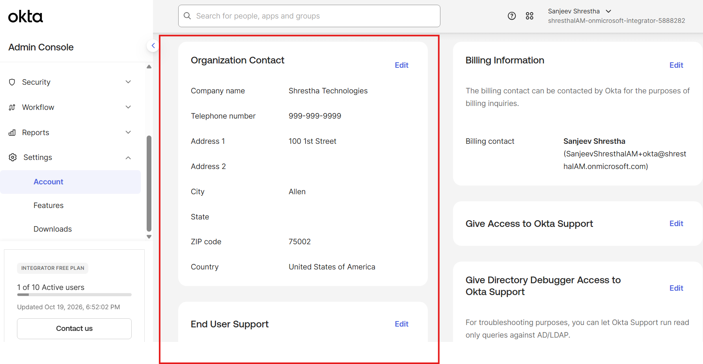
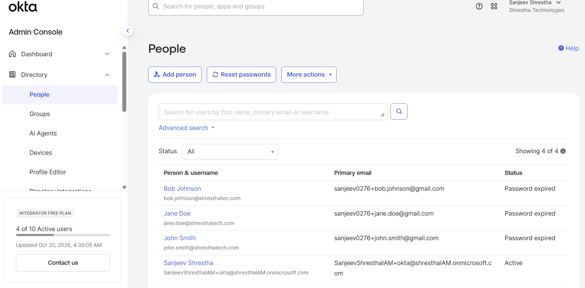
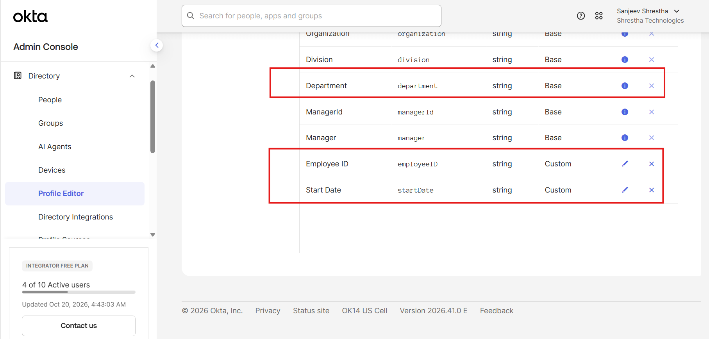
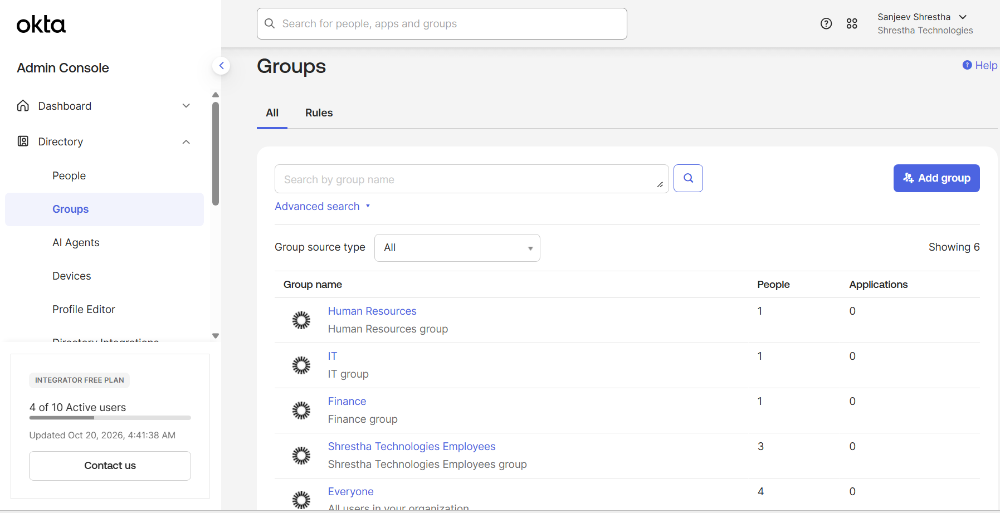
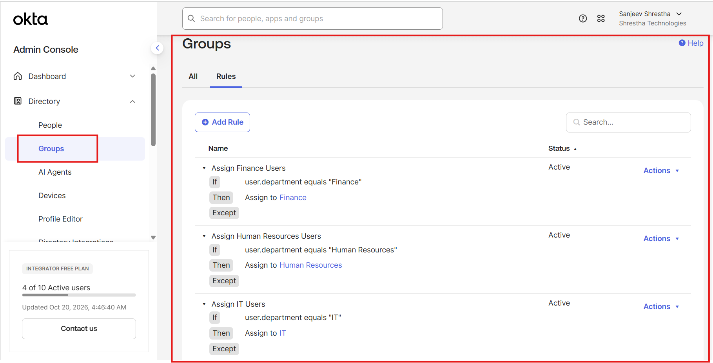
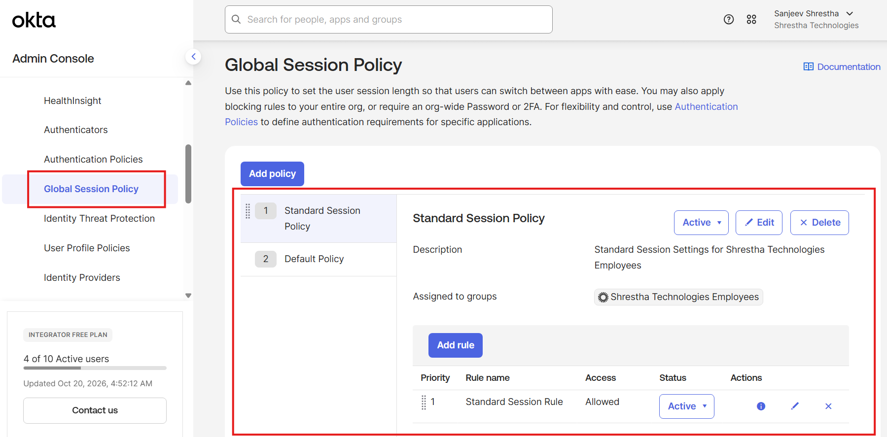
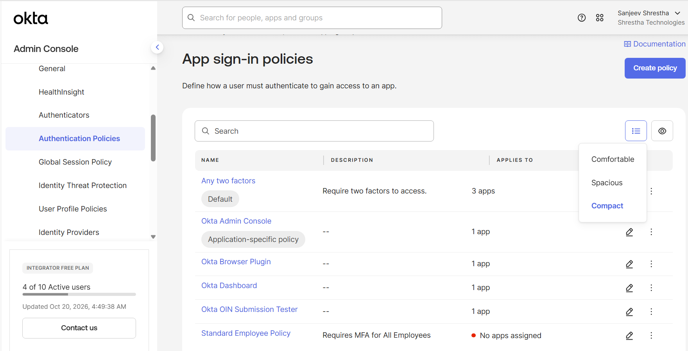
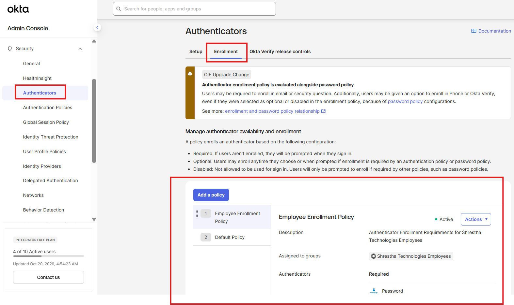
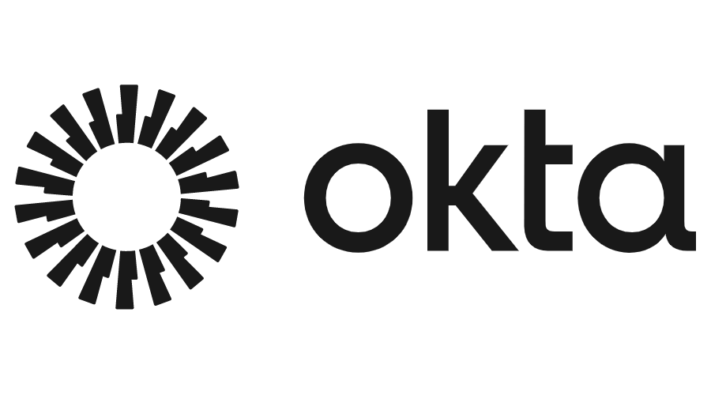

# Okta IAM Lab Series - My Hands-On Labs
**By:** Sanjeev Shrestha | Dallas–Fort Worth Area, Texas, USA  
**Okta Org** Integrator Free Plan at [developer.okta.com](https://developer.okta.com)  
**My org:** <my-okta-org> admin.okta.com  
**Goal:** IAM Engineer/Developer roles - 2027 - Preparing for Okta Certified Professional (OCP)  
**Original:** Forked from RyanKennon/Okta-Lab-Series

## Skills Demonstrated
* Okta Administration
* User Lifecycle Management
* Group-Based Access Control
* RBAC Design
* SAML Federation
* MFA Policies
* Active Directory Integration
* JML Automation
  
## My Progress
- [x] Lab 1: Tenant Setup - Done Oct 19 2026 
- [ ] Lab 2: AD Integration - In Progress
- [ ] Lab 3: RBAC
- [ ] Lab 4: SAML SSO
- [ ] Lab 5: MFA / Adaptive
- [ ] Lab 6: JML Lifecycle

## Lab Evidence (screenshots from my org)
### Lab 1 - Okta Tenant Setup & Configuration
  
### **Lab 1 - Architecture Diagram:**  
  
### **Organization Contact:**  

### **People:**  

### **Custom Profile Attributes:**  

### **Groups:**  

### **Group Rules:**  

### **Global Session Policy:**  

### **Authentication Policies:**  

### **Authenticator Enrollment Policy:**  

## Lab 1 - Key Learnings
- Learned how to set up a clean Okta tenant from scratch - Branding, People, Custom Profile Attributes, and how Global Session Policy is separate from Authentication Policies and Authenticator Enrollment Policy.
- Learned to build the foundation right - People, Groups, and Group Rules first, so later RBAC and SAML apps just work with automated assignments instead of manual adds.

  

# Okta IAM Lab Series
This repository serves as the central hub for the Okta IAM Lab Series — a collection of hands-on identity and access management labs built around the Okta Identity Cloud platform. Each lab builds on the previous one, starting with foundational Okta tenant configuration and progressively covering Active Directory integration, SAML-based Single Sign-On, Multi-Factor Authentication, and JML lifecycle automation. All labs are performed in a live Okta trial org and reflect real-world IAM practices aligned with the responsibilities of an entry-level IAM Analyst or Identity Engineer. The series is designed to build a comprehensive Okta portfolio demonstrating hands-on proficiency across the core competencies tested in the Okta Certified Professional (OCP) exam and commonly required in IAM Analyst job descriptions.

---

## Prerequisites
The following are required before starting the Okta IAM Lab Series:

- **Okta Trial Org** — Sign up for a free Integrator Free Plan at [developer.okta.com](https://developer.okta.com). This org will be used across all labs in the series and should not be deleted between labs.
- **Microsoft Azure Account** — A personal Azure account with an active subscription is required for labs involving Active Directory. Sign up for a free account with $200 in credits at [azure.microsoft.com/free](https://azure.microsoft.com/free).
- **Windows Server 2022 VM** — Required for Active Directory labs. Follow the setup steps in the [Active Directory Enterprise Administration Lab](https://github.com/RyanKennon/Active-Directory) through the **Create Organizational Units** section before starting Lab 2.
- **GitHub Account** — Required to follow along with lab documentation and host your own portfolio.
- **Basic Familiarity with Active Directory** — Labs 2 and 3 assume basic knowledge of Active Directory concepts such as users, groups, and organizational units. Complete the [Active Directory Enterprise Administration Lab](https://github.com/RyanKennon/Active-Directory) if you are new to Active Directory.

---

## Labs

- [Okta Tenant Setup & Configuration](https://github.com/RyanKennon/Okta-Tenant-Setup)
- [Okta Active Directory Integration](https://github.com/RyanKennon/okta-AD-integration)
- [Okta RBAC Design & Implementation](https://github.com/RyanKennon/Okta-RBAC)
- [Okta SAML 2.0 Application Integration](https://github.com/RyanKennon/okta-enterpirse-sso)
- [Okta MFA and Adaptive Authentication](https://github.com/RyanKennon/okta-mfa-adaptive-authentication)
- [Okta JML Lifecycle Automation](https://github.com/RyanKennon/okta-jml-lifecycle-automation)
