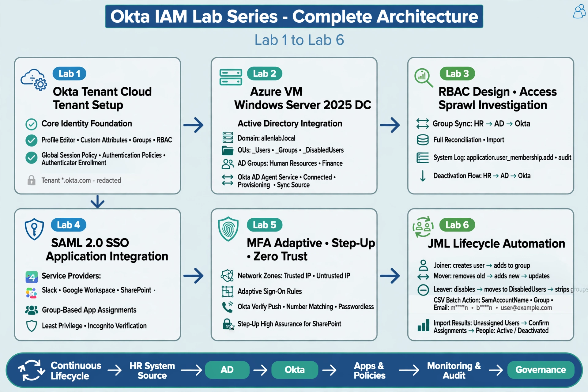

# Okta IAM Lab Series - Hands-On Architecture & Implementation

**Author:** Sanjeev Shrestha | Dallas–Fort Worth Area, TX (Shrestha Technologies)  
**Target Roles:** IAM Engineer / Identity Engineer / Okta Administrator / Entra ID Engineer (2027)  
**Certification Focus:** Preparing for Okta Certified Professional (OCP)  
**Environment:** Okta Developer Tenant (*.okta.com - redacted) 

## 6 Labs Architecture Overview
Conceptual HR Source (simulated) → AD `allenlab.local` → Okta `*.okta.com - redacted` → RBAC Groups → Apps (Slack, Workspace, SharePoint) → Adaptive MFA / Zero Trust → JML Automation
 

## Quick Navigation & Lab Execution Status

| Lab       | Focus Area                                | Status    | Jump to Lab                                                                  |
|-----------|-------------------------------------------|-----------|------------------------------------------------------------------------------|
| **Lab 1** | Tenant Setup & Core Identity Foundation   | Completed | [Go to Lab 1](#lab-1-okta-tenant-setup--configuration)                       |
| **Lab 2** | Active Directory Integration & DelAuth    | Completed | [Go to Lab 2](#lab-2-active-directory-integration--delegated-authentication) |
| **Lab 3** | RBAC Design & Access Sprawl Investigation | Completed | [Go to Lab 3](#lab-3-rbac-design--access-sprawl-investigation)               |
| **Lab 4** | SAML 2.0 Application Integration          | Completed | [Go to Lab 4](#lab-4-saml-20-application-integration)                        |
| **Lab 5** | Adaptive MFA, Step-Up & Zero Trust        | Completed | [Go to Lab 5](#lab-5-adaptive-mfa-step-up-authentication--zero-trust)        |
| **Lab 6** | JML Lifecycle Automation                  | Completed | [Go to Lab 6](#lab-6-okta-jml-lifecycle-automation)                          |

---
## Executive Summary & Business Impact

Implemented an end-to-end IAM environment using Okta, Active Directory, SAML federation, Adaptive MFA, RBAC, and automated Joiner-Mover-Leaver lifecycle processes across six hands-on labs.

* **Tenant Foundation (Lab 1):** Core Okta tenant `*.okta.com - redacted`, custom profile attributes, Groups RBAC, Global Session + Auth + Enrollment Policies.
* **Access Governance (Lab 3+4):** Group-based provisioning, access-sprawl audit via System Log `application.user_membership.add`, least-privilege via group app assignments for Slack, Workspace, SharePoint.
* **Lifecycle Automation (Lab 2+6):** AD `allenlab.local` as source with DelAuth + Full/Incremental Import via AD Agent, JML automation with PowerShell + CSV batch `jml-batch.csv`, Unassigned → Confirm → Active/Deactivated.
* **Centralized Auth (Lab 4):** SAML 2.0 federation with attribute mapping across Slack, Google Workspace, SharePoint.
* **Zero Trust (Lab 5):** Network Zones Trusted/Untrusted IP, Adaptive Sign-On + Step-Up High Assurance for SharePoint, Passwordless Okta Verify Push with Number Matching.
* **Users Managed:** 20+ AD users, 6 Groups, 3 SAML Apps, 22 MFA policies

---

## Key Skills Demonstrated

* Okta Tenant Administration & Profile Editor
* Active Directory (AD) Integration & Delegated Authentication
* Role-Based Access Control (RBAC) Design
* SAML 2.0 SSO Federation & Attribute Mapping
* Adaptive Risk-Based Authentication & Network Zones
* Step-Up Authentication & Passwordless Policies
* User Lifecycle Management (JML) & Access Sprawl Audit

## Detailed Lab Implementations & Visual Proof

### Lab 1: Okta Tenant Setup & Configuration

**Key Learnings & Takeaways:**
* Established core tenant infrastructure including branding, directory schema, custom profile attributes, and group structures prior to app assignments.
* Isolated Global Session Policies from application-level Authentication Policies and Authenticator Enrollment Policies to maintain granular access control.

📸 <b>Click to view Lab 1 Diagrams & Screenshots</b>

 

#### Architecture Diagram

#### Administration & Configuration Captures
* **Organization Contact:**  
  
* **People Directory:**  
  
* **Custom Profile Attributes:**  
  
* **Group Management:**  
  
* **Automated Group Rules:**  
  
* **Global Session Policy:**  
  
* **Authentication Policies:**  
  
* **Authenticator Enrollment Policy:**  
  

---
**[↑ Back to Lab Execution Status](#quick-navigation--lab-execution-status)**

### Lab 2: Active Directory Integration & Delegated Authentication

**Key Learnings & Takeaways:**
* Configured Active Directory as the authoritative source of truth for user lifecycle operations (`allenlab.local`).
* Evaluated standard import workflows: **Incremental Import** for daily delta synchronization vs. **Full Import** for initial reconciliation and bulk schema updates.

📸 <b>Click to view Lab 2 Diagrams & Screenshots</b>

 

#### Architecture Diagram

#### Active Directory Integration Proof
* **AD to Okta Provisioning Pipeline:**  
  
* **Delegated Authentication Enabled:**  
  
* **AD Profile Mapping:**  
  
* **Okta User Profile Mapping:**  
  

---
**[↑ Back to Lab Execution Status](#quick-navigation--lab-execution-status)**

### Lab 3: RBAC Design & Access Sprawl Investigation

**Key Learnings & Takeaways:**
* Enforced end-to-end lifecycle flow: `HR → AD → Okta`. Tested AD account disablement and verified the resulting Okta lifecycle state. Session revocation and downstream application access require separate validation.
* Audited governance bypasses in Okta System Logs (`application.user_membership.add`) to detect direct user-to-app assignments and restore strict RBAC posture.

📸 <b>Click to view Lab 3 Diagrams & Screenshots</b>

 

#### Architecture Diagram

#### RBAC & Deprovisioning Proof
* **Group Sync Verification:**  
  
* **Full Reconciliation Import:**  
  
* **Lifecycle Deactivation (AD side):**  
  
* **Lifecycle Deactivation (Okta side):**  
  
* **Access Sprawl Investigation & Audit Report:**  
    
  

---
**[↑ Back to Lab Execution Status](#quick-navigation--lab-execution-status)**

### Lab 4: SAML 2.0 Application Integration

**Key Learnings & Takeaways:**
* Configured custom SAML 2.0 integrations with multiple Service Providers (Slack, Google Workspace, SharePoint).
* Applied least-privilege entitlements through group memberships rather than direct assignments. Verified user access segregation across distinct user profiles in Incognito test sessions.

📸 <b>Click to view Lab 4 Diagrams & Screenshots</b>

 

#### Architecture Diagram

#### SAML Integration Proof
* **Custom SAML Configuration:**  
    
    
  
* **Group-Based Application Assignments:**  
    
  
* **Least Privilege Access Verification:**  
  * *Finance User (John Smith - Limited Access):*  
    
  * *HR & Cloud Admin (Lisa Park - Extended Access):*  
    

---
**[↑ Back to Lab Execution Status](#quick-navigation--lab-execution-status)**

### Lab 5: Adaptive MFA, Step-Up Authentication & Zero Trust

**Key Learnings & Takeaways:**
* Defined trusted vs. untrusted IP Network Zones. Constructed Adaptive Sign-On Rules to require MFA or block access based on client network context.
* Enforced step-up authentication policies on high-value resources (e.g., SharePoint) to challenge active sessions upon accessing sensitive data.

📸 <b>Click to view Lab 5 Diagrams & Screenshots</b>

 

#### Architecture Diagram

#### MFA & Policy Verification
* **Authenticator Enrollment & Passwordless Setup:**  
    
  
* **Network Zones & Adaptive Rules:**  
    
    
  
* **Step-Up Authentication Engine:**  
    
    
  
* **User Authentication Testing:**  
    
  

---
**[↑ Back to Lab Execution Status](#quick-navigation--lab-execution-status)**

### Lab 6: Okta JML Lifecycle Automation

**Key Learnings & Takeaways:**
- Automates Joiner, Mover, and Leaver lifecycle actions using PowerShell and Active Directory.
- Uses the Okta AD Agent and Full/Incremental Import to validate applicable AD changes in Okta.
- Supports CSV-driven batch processing for multiple lifecycle actions.

📸 <b>Click to view Lab 6 Diagrams & Screenshots</b>

 

#### Architecture Diagram

#### Joiner Mover Leaver Lifecycle
* **Joiner Onboarding Script:**  
      
* **IT Confirmation:**  
    
* **Mover Script:**  
      
* **Finance Confirmation:**  
  
* **Leaver Script:**  
  
* **Deactivation Confirmation:**  
  
* **CSV Driven Batch Processing:**  
  
* **Activated Deactivated Confirmation:** 
  
* **HR Group Confirmation:** 
  
* **Finance Group Confirmation:** 
  

---
#### 📂 Code & Automation Artifacts (Direct Inspect)
- **Joiner:** [`scripts/Joiner.ps1`](scripts/Joiner.ps1) — Create a user and assign configured groups.
- **Mover:** [`scripts/Mover.ps1`](scripts/Mover.ps1) — Update user attributes and change group memberships.
- **Leaver:** [`scripts/Leaver.ps1`](scripts/Leaver.ps1) — Disable the account and remove configured group memberships.
- **CSV input:** [`csv-file/Jml-Batch.csv`](csv-file/Jml-Batch.csv) — Batch lifecycle records.
- **Batch runner:** [`scripts/JML-Batch.ps1`](scripts/JML-Batch.ps1) — Process CSV records with validation.

#### Validation and Limitations

AD and Okta state changes do not, by themselves, prove downstream application deprovisioning or active-session revocation. Those outcomes require separate validation.

**[↑ Back to Lab Execution Status](#quick-navigation--lab-execution-status)**

---

## Original Repository & Credits
This hands-on lab series was adapted and built upon the foundational framework provided by [RyanKennon/Okta-Lab-Series](https://github.com/RyanKennon/Okta-Lab-Series). Full original references can be found in [REFERENCE.md](REFERENCE.md).

