# Okta IAM Lab Series - My Hands-On Labs
  
**By:** Sanjeev Shrestha | Dallas–Fort Worth Area, Texas, USA  
**Okta Org** Integrator Free Plan at [developer.okta.com](https://developer.okta.com)  
**My org:** *.okta.com (redacted)  
**Goal:** IAM Engineer/Developer roles - 2027 - Preparing for Okta Certified Professional (OCP)  
**Original:** Forked from RyanKennon/Okta-Lab-Series

## Skills Demonstrated
* Okta Administration
* User Lifecycle Management
* Group-Based Access Control
* RBAC Design
* SAML Federation
* MFA Policies
* Active Directory Integration
* JML Automation

## Business Problems Solved
* Reduced manual app assignments using group-based access.
* Implemented least privilege access model.
* Demonstrated AD-to-Okta lifecycle automation.
* Implemented SAML federation for centralized authentication.
* Reduced access sprawl through RBAC design.
* Prevented credential theft and push fatigue using Okta Verify Push with Number Matching and TOTP fallback.
* Enforced adaptive risk-based access using sign-on policies and network zone-based access rules.
* Secured sensitive applications with step-up authentication and authenticator enrollment policies, enabling passwordless.
  
## My Progress
- [x] Lab 1: Tenant Setup - Completed Oct 19, 2026 
- [x] Lab 2: AD Integration - Completed Oct 21, 2026
- [x] Lab 3: RBAC - Completed Oct 21, 2026
- [x] Lab 4: SAML SSO - Completed Oct 21, 2026
- [x] Lab 5: MFA / Adaptive - Completed Oct 22, 2026
- [ ] Lab 6: JML Lifecycle - In Progress

## Lab Evidence (screenshots from my org)
**Jump to lab:**
- [Lab 1 – Tenant Setup](#lab-1---okta-tenant-setup--configuration)
- [Lab 2 – AD Integration](#lab-2---okta-active-directory-integration)
- [Lab 3 – RBAC](#lab-3---okta-rbac-design-and-implementation)
- [Lab 4 – SAML SSO](#lab-4---okta-saml-20-application-integration)
- [Lab 5 – MFA / Adaptive](#lab-5---okta-mfa-and-adaptive-authentication)
  

### Lab 1 - Okta Tenant Setup & Configuration
### **Lab 1 - Architecture Diagram:**  
  
### **Organization Contact:**  

### **People:**  

### **Custom Profile Attributes:**  

### **Groups:**  

### **Group Rules:**  

### **Global Session Policy:**  

### **Authentication Policies:**  

### **Authenticator Enrollment Policy:**  

## Lab 1 - Key Learnings:
- Learned how to set up a clean Okta tenant from scratch - Branding, People, Custom Profile Attributes, and how Global Session Policy is separate from Authentication Policies and Authenticator Enrollment Policy.
- Learned to build the foundation right - People, Groups, and Group Rules first, so later RBAC and SAML apps just work with automated assignments instead of manual adds.

**[↑ Back to Lab Evidence](#lab-evidence)**
  

### Lab 2 - Okta Active Directory Integration 
### **Lab 2 - Architecture Diagram:**  
  
### **From AD To Okta:**  

### **Enabled Delegated Authentication:**  

### **User Profile Mapping AD:**  

### **User Profile Mapping Okta:**  

## Lab 2 - Key Learnings:
- In this lab configuration, AD is authoritative for the configured user lifecycle. — _Users OU allenlab.local creates user
- Incremental vs Full Import — Incremental = only changed objects, Full = all 4 users + 26 groups — Use Incremental for daily, Full for fixes
  
**[↑ Back to Lab Evidence](#lab-evidence)**
  

### Lab 3 - Okta RBAC Design and Implementation  
### **Lab 3 - Architecture Diagram:**  
  
### **Okta Group Sync:**  

### **Full Import:**  

### **Sarah Disabled AD:**  

### **Sarah Deactivated Okta:**  

### **Access Sprawl Investigation:**  

### **Access Sprawl Report:**  

## Lab 3 - Key Learnings:
- HR → AD → Okta lifecycle — In this lab, AD is authoritative for the configured user lifecycle. AD as single source of truth _Users/_Groups/_DisabledUsers
- Detect sprawl via System Log application.user_membership.add direct assign John Smith → SCIM App. Investigate direct assignments for possible governance bypass; validate approved exceptions before remediation.
  
**[↑ Back to Lab Evidence](#lab-evidence)**
 

### Lab 4 - Okta SAML 2.0 Application Integration
### **Lab 4 - Architecture Diagram:**  
  
### **Custom SAML App Creation 1:**  
 
### **Custom SAML App Creation 2:**  
 
### **Custom SAML App Creation 3:**  

### **Group Based App Access:**  

### **Multiple SP Configuration:**  
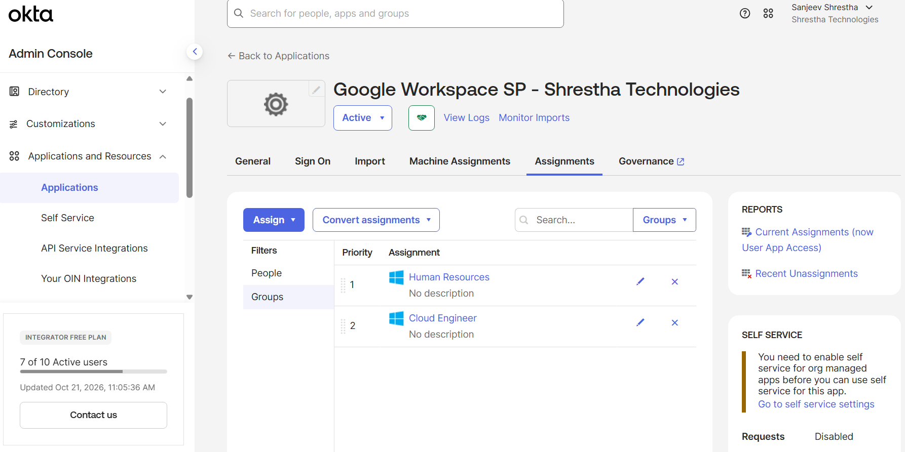
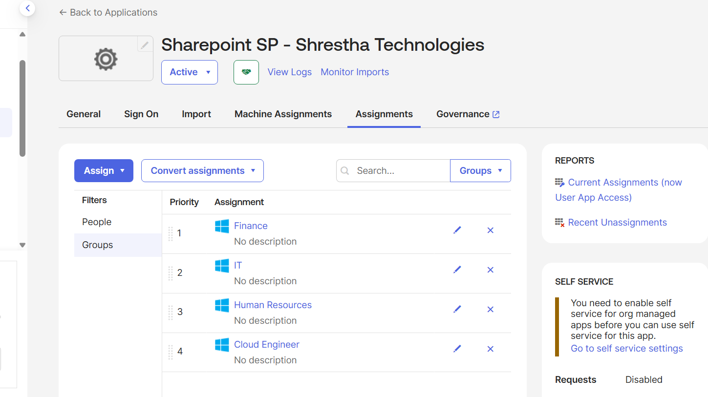
### **Least privilege Access. John Smith (Finance) sees Slack and Sharepoint only:**  

### **Least privilege Access. Lisa Park (HR+Cloud) sees all 3 Slack/Google Workspace/Sharepoint :**  

## Lab 4 - Key Learnings:
- Group-based app access Finance→2 apps, HR+Cloud→3 apps. Assign Finance/IT/HR/Helpdesk/Cloud Engineer groups to Slack/Google Workspace/Sharepoint — never direct People
- Least privilege matrix. John Smith (Finance) sees Slack+Sharepoint only — Lisa Park (HR+Cloud) sees all 3 — test in Incognito
  
**[↑ Back to Lab Evidence](#lab-evidence)**

### Lab 5 - Okta MFA and Adaptive Authentication
### **Lab 5 - Architecture Diagram:**  
  
### **1) Enroll Okta Verify:**  
 
### **Passwordless Enrollment 1:**  
 
### **Passwordless Enrollment 2:**  
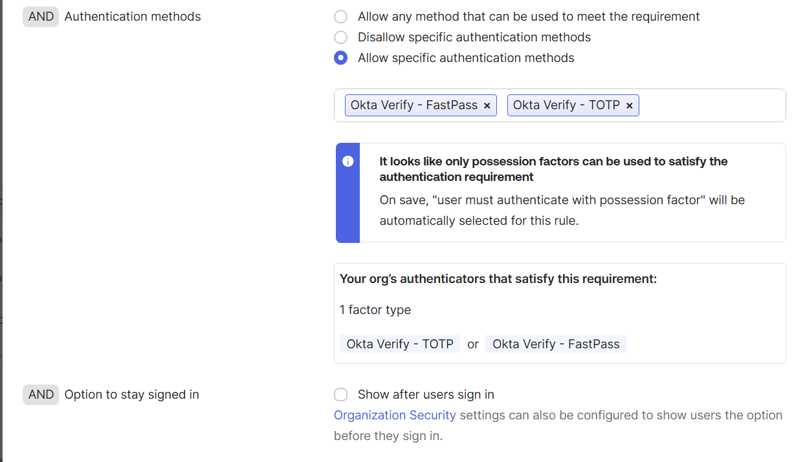 
### **Passwordless Enrollment 3:**  
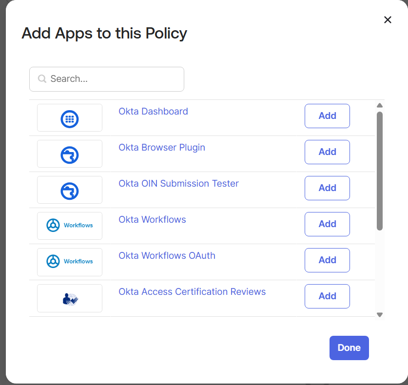 
### **Passwordless Enrollment 4:**  
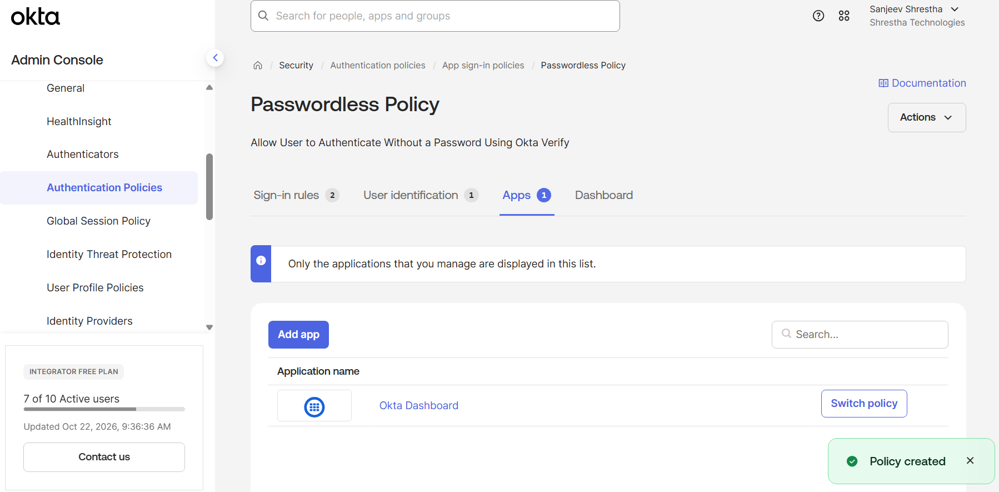 
### **Passwordless Enrollment 5:**  
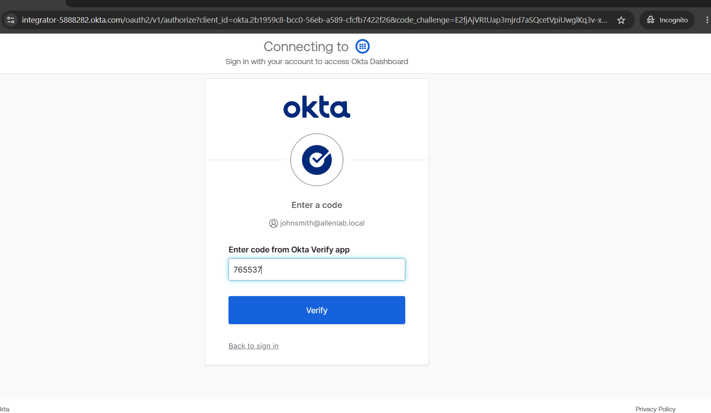 
### **Network Zones:**  

### **Risk Based Adaptive MFA Policy Outside Network:**  

### **Risk Based Adaptive MFA Policy Corporate:**  

### **Step Up Authentication 1:**  

### **Step Up Authentication 2:**  

### **Step Up Authentication 3:**  

### **John Smith Username:**  
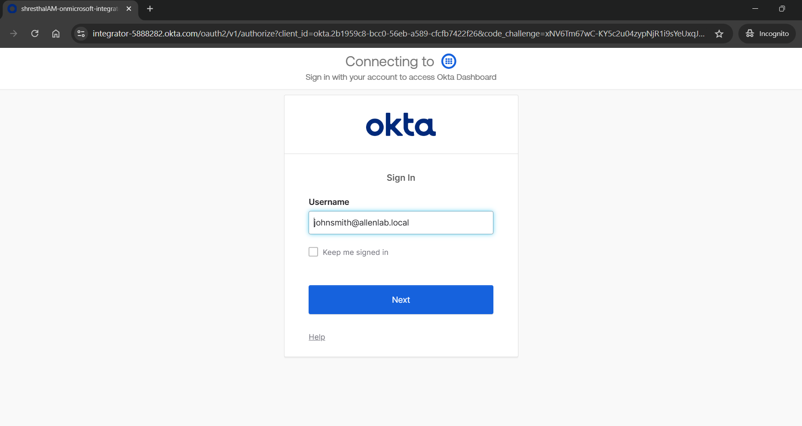
### **John Smith Password:**  
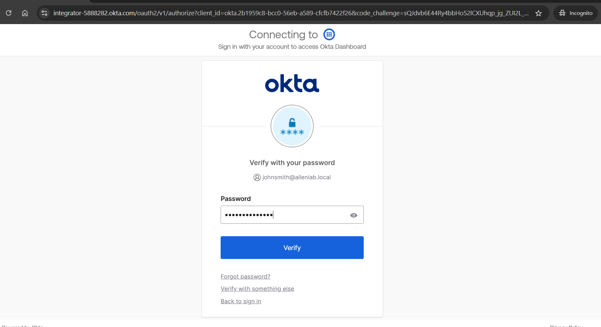
### **John Smith Access:**  

### **AuthenticatorEnrollment Policy:**  
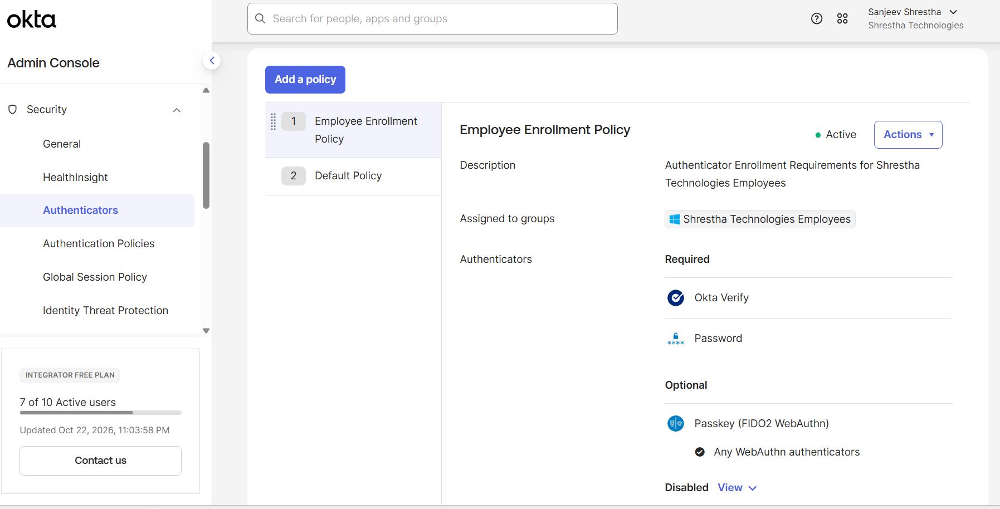
### **Jane Doe Username:**  
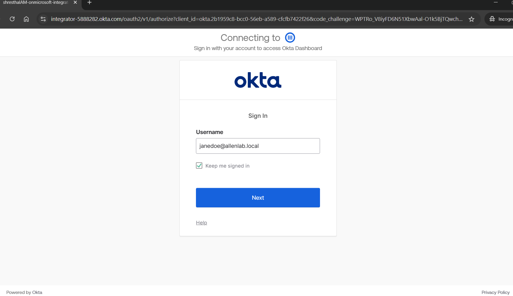
### **Jane Doe Password:**  
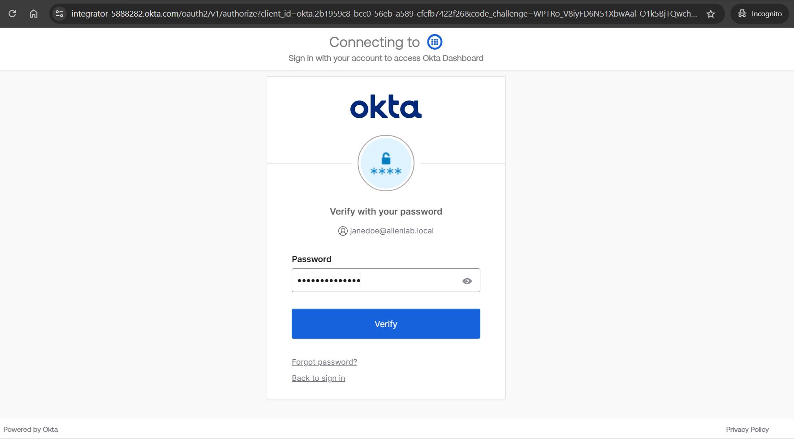
### **Jane Doe Access:**  

## Lab 5 - Key Learnings:
- Step-up authentication for sensitive apps. Sharepoint Finance/HR sensitive — Requires MFA re-challenge even if session valid — Lab 5 step-up for sensitive applications — Prevents session hijack after initial login
- Network Zone-based access rules define trusted vs untrusted IPs. Create Security → Networks → Zones — Define Dallas Trusted Zone = [REDACTED_IP] range / Corp IPs — Allow vs Block — Sign-on Policy: If inside Dallas zone → MFA optional, Outside → MFA required + Deny — Without zone, user can login from any country — Need zone for real production environment in Dallas
  
**[↑ Back to Lab Evidence](#lab-evidence)**

**Original:** Forked from [RyanKennon/Okta-Lab-Series](https://github.com/RyanKennon/Okta-Lab-Series) — Full original description in [REFERENCE.md](REFERENCE.md) 
